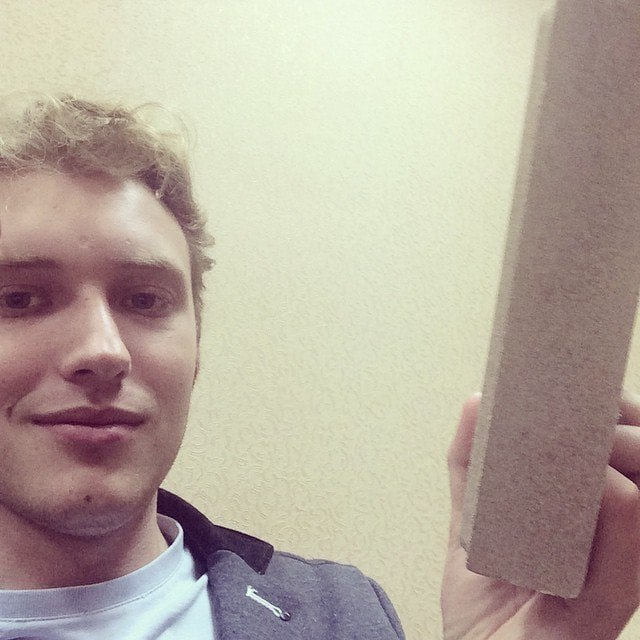

# batek-rs-tg

Телеграм-бот про батька. АНДРЕЙ ПИДОРАСИК.

Внутри один бинарник на Rust: без базы, без Discord, без ffmpeg, без Python.
Снаружи только Telegrams Bot API и, для команд со случайными видео, бинарник
`yt-dlp` в PATH.

## Что умеет

| Команда | Что делает |
|---|---|
| `/start` | приветствие |
| `/help` | короткий ответ, какой есть |
| `/grandmobile` | паста про гранд мобайл |
| `/batek` | 90% случайный шортс или видео с канала, 10% шутка |
| `/timur` | то же для второго канала |
| `/victorovich` | то же для третьего канала |
| `/meme [имя]` | мем из `music/`, `fotos/` или `video/`, без имени случайный |
| `/triggers [все]` | отладка: каждое фото с подписью, какие слова его вызывают; аргумент `все` раскрывает и видео с аудио; работает только у пользователя из `TG_DEBUG_USER_ID` |
| `/bomjara` | случайный из двух клипов |
| `/roflvideo` | `makuos` или `shefos` |
| `/kupyansk` | `kupyanskdis` |
| `/batekfetch` | система, память, диск, uptime |
| `/play`, `/stop` | отвечают, что голос только в Discord |

Кроме команд:

- в группах бот реагирует на слова: «бомжара», «бомж», `bomjara`,
  `bomzhara`, `manjaro`, «манжара», «макуос», `makuos`, «марк адерли»,
  «шефос», `shefos`, «пингвин320кг», `320`, «гранд мобайл», «белые розы»,
  а также «укр», «база», «кот», «казан», «боб», `bob`, `vpn`, `vk`,
  «дедлок» и другие из общей таблицы в `src/keywords.rs`. У каждого
  действия есть вариант и кириллицей, и латиницей или транслитом. Поиск
  понимает транслит в обе стороны, лимит один ответ в 20 секунд на слово
  в чат;
- мем-реакция на ключевое слово срабатывает с шансом 35%: фото и видео
  из таблицы уходят в чат не на каждое совпадение, молчание не занимает
  слот лимита; текстовые реакции без файла играют по старым правилам;
- фото из `fotos/` работают как обычные мемы: `/meme имя`, упоминание
  `@batek_rs_tg_bot <имя>` и инлайн-поиск по имени или алиасу;
- упоминание `@batek_rs_tg_bot <имя мема>` отправляет мем;
- инлайн-режим: `@batek_rs_tg_bot` показывает меню команд и мемов, а текст
  запроса ищет мем по имени и по ключевым словам.

## Сборка и запуск

```bash
cargo build --release
cp .env.example .env    # вписать TELEGRAM_TOKEN
BATEK_ROOT=. ./target/release/batek-rs-tg
```

`BATEK_ROOT` указывает на каталог с `music/`, `fotos/`, `video/` и
`yt_cache.json`.
Без переменной бот ищет `music/` в текущем каталоге или на уровень выше.

`yt-dlp` нужен только для `/batek`, `/timur`, `/victorovich` и случайных
ссылок в инлайне. Без него эти команды честно скажут, что видео недоступны,
остальное продолжит работать.

## Telegram

1. `@BotFather` → `/newbot`, получить токен.
2. `/setprivacy` → Disable, иначе в группах бот не увидит обычные сообщения.
3. `/setinline` → Enable, иначе не будет инлайн-меню.
4. Токен в `.env` в `TELEGRAM_TOKEN`.
5. При желании `TG_CACHE_CHAT` это id приватного канала, куда бот один раз
   загрузит все мемы, чтобы инлайн работал сразу. Без него мемы попадают в
   инлайн-кэш после первого `/meme`.

## Docker

```bash
docker compose up -d --build
```

Образ Alpine, внутри бинарник, `yt-dlp`, `music/`, `fotos/` и `video/`.
Процесс не от root. Кэш YouTube и медиа живут в томе `/app`, поэтому после
обновления файлов в репозитории, включая новый каталог `fotos/`, том нужно
пересоздать:

```bash
docker compose down
docker compose up -d --build
```

Без пересоздания старый `/app` останется без `fotos/` и бот скажет, что
фото нет.

## Размер и вес

Сборка `strip = true`, релизный бинарник 8 057 064 байт (7.7 МиБ). RSS
процесса в покое 7.3 МБ по `/proc/1/status`; `docker stats` показывает около
100 МБ, потому что в cgroup попадает файловый кеш. Содержимое образа 114 МБ
по `du -shx /`, `docker images` показывает 226 МБ из-за учёта слоёв.
Числа сняты 2026-11-06.

## Проверки

```bash
cargo fmt --check
cargo clippy --all-targets -- -D warnings
cargo test
cargo build --release
```

Тесты идут на реальных файлах из `music/`, `fotos/` и `video/`, без моков и
без сети.
Живая проверка в Telegram остаётся за владельцем, машина не изображает
пользователя.


